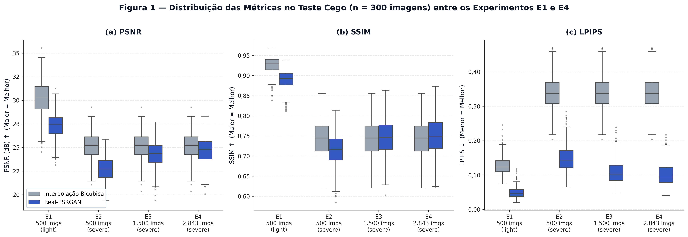
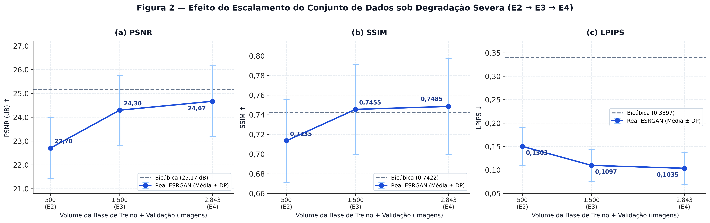
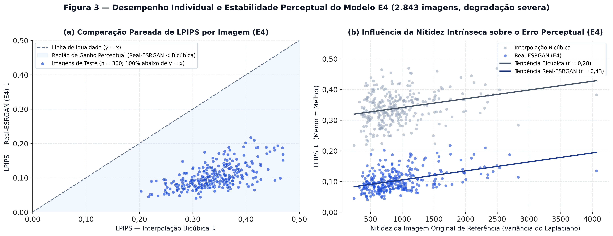

# Super-Resolução Facial com Real-ESRGAN: Análise de Degradação e Escala de Dados

Repositório do Trabalho de Conclusão de Curso (TCC) em **Ciência da Computação** pela **Universidade Federal de Sergipe (DCOMP/UFS)** produzido pelo discente Levi Ribeiro Santiago de Mendonça.

O projeto investiga o comportamento da arquitetura **Real-ESRGAN** na tarefa de super-resolução facial ($2\times$, de $64 \times 64$ para $128 \times 128$ pixels) utilizando a base **Flickr-Faces-HQ (FFHQ) small**, avaliando sistematicamente o impacto da severidade da degradação sintética e do volume de dados de treinamento sobre o *Perception-Distortion Trade-off* (PSNR, SSIM e LPIPS).

---

## 1. Matriz Experimental e Reprodutibilidade

Todas as execuções utilizam particionamento determinístico (`SEED = 42`) sobre o total de **3.143 imagens** da base, retendo exatamente as **mesmas 300 imagens** para o conjunto de teste cego e destinando até **2.843 imagens** para treino e validação. Cada experimento está versionado por meio de tags semânticas no repositório:

| Experimento | Tag Git | Base Treino + Validação | Degradação Sintética | Ambiente |
| :--- | :--- | :---: | :---: | :---: |
| **E1** | `v1.0-E1` | `500` imagens | `light` (Blur + Redimensionamento) | Google Colab |
| **E2** | `v1.0-E2` | `500` imagens | `severe` (Blur + Bicúbica + Ruído + JPEG) | Google Colab |
| **E3** | `v1.0-E3` | `1.500` imagens | `severe` (Blur + Bicúbica + Ruído + JPEG) | Kaggle (T4) |
| **E4** | `v1.0-E4` | `2.843` imagens | `severe` (Blur + Bicúbica + Ruído + JPEG) | Kaggle (T4) |

---

## 2. Resultados no Teste Cego ($n = 300$ imagens)

Os modelos foram avaliados comparativamente à **Interpolação Bicúbica** utilizando métricas de distorção pixel a pixel (**PSNR** $\uparrow$), similaridade estrutural (**SSIM** $\uparrow$) e distância perceptual (**LPIPS** $\downarrow$):

| Cenário / Modelo | Base de Treino | PSNR (dB) $\uparrow$ | SSIM $\uparrow$ | LPIPS $\downarrow$ | Vitória LPIPS vs. Bicúbica |
| :--- | :---: | :---: | :---: | :---: | :---: |
| **Bicúbica (`light`)** | — | `30,19 ± 1,99` | `0,9256 ± 0,0216` | `0,1274 ± 0,0277` | — |
| **Real-ESRGAN — E1 (`light`)** | `500` imgs | `27,27 ± 1,46` | `0,8887 ± 0,0244` | **`0,0496 ± 0,0167`** | `100,0%` (`300/300`) |
| **Bicúbica (`severe`)** | — | `25,17 ± 1,54` | `0,7422 ± 0,0457` | `0,3397 ± 0,0510` | — |
| **Real-ESRGAN — E2 (`severe`)** | `500` imgs | `22,70 ± 1,28` | `0,7135 ± 0,0421` | `0,1503 ± 0,0403` | `100,0%` (`300/300`) |
| **Real-ESRGAN — E3 (`severe`)** | `1.500` imgs | `24,30 ± 1,46` | `0,7455 ± 0,0459` | `0,1097 ± 0,0341` | `100,0%` (`300/300`) |
| **Real-ESRGAN — E4 (`severe`)** | `2.843` imgs | **`24,67 ± 1,49`** | **`0,7485 ± 0,0487`** | **`0,1035 ± 0,0341`** | **`100,0%` (`300/300`)** |

### Principais Conclusões
* **Ganho perceptual consistente:** O Real-ESRGAN superou a interpolação bicúbica em **100% das 300 imagens de teste** na métrica LPIPS em todos os cenários, reduzindo a distância perceptual em **69,5%** no `E4` (`0,3397` $\rightarrow$ `0,1035`).
* **Efeito de escala sob degradação severa:** Ampliar o conjunto de treino de `500` (`E2`) para `2.843` imagens (`E4`) elevou o PSNR em `+1,97 dB` ($p < 0,001$), aumentou o SSIM em `+0,0349` ($p < 0,001$) — superando estatisticamente a linha de base bicúbica ($p = 0,0138$) — e reduziu o LPIPS em `-31,1%`.

### Análise Visual dos Resultados


*Figura 1 — Distribuição das métricas PSNR, SSIM e LPIPS no conjunto de teste cego (n = 300 imagens) entre os experimentos E1 e E4.*


*Figura 2 — Efeito do escalamento do volume de treinamento (500, 1.500 e 2.843 imagens) sob degradação severa (E2 → E3 → E4).*


*Figura 3 — Comparação pareada de LPIPS por imagem e influência da nitidez de referência no modelo E4.*

---

## 3. Estrutura do Repositório

```text
tcc-realesrgan-face-sr/
├── assets/
│   ├── fig1_distribuicao_e1_e4.png    # Boxplots comparativos das métricas (E1 a E4)
│   ├── fig2_escala_dados_severa.png   # Curvas de escala de dados (E2 → E3 → E4)
│   └── fig3_analise_pareada_e4.png    # Análise pareada e efeito da nitidez no E4
├── notebooks/
│   ├── Experimento_GAN.ipynb          # Caderno de execução no Google Colab (E1 e E2)
│   └── Experimento_GAN_Kaggle.ipynb   # Caderno de execução no Kaggle (E3 e E4)
├── src/
│   └── realesrgan/
│       ├── config.py                  # Painel centralizado de hiperparâmetros e semente
│       ├── prepare_data.py            # Particionamento determinístico e degradação sintética
│       ├── dataset.py                 # Carregamento de pares LR/HR
│       ├── model.py                   # Arquitetura do Gerador (RRDBNet) e Discriminador
│       ├── loss.py                    # Funções de perda Pixel (L1) e Perceptual (VGG-19)
│       ├── train_realesrgan.py        # Loop de treinamento, validação e checkpoints
│       ├── evaluate.py                # Avaliação cega (PSNR, SSIM, LPIPS) e exportação CSV
│       └── utils.py                   # Controle de sementes, ordenação e grades visuais
├── requirements.txt                   # Dependências do ambiente Python
└── README.md
```

---

## 4. Como Reproduzir

### Clonar o repositório ou restaurar um experimento específico
```bash
git clone [https://github.com/leviribeiro7/tcc-realesrgan-face-sr.git](https://github.com/leviribeiro7/tcc-realesrgan-face-sr.git)
cd tcc-realesrgan-face-sr

# Opcional: restaurar a configuração exata de qualquer experimento (v1.0-E1 a v1.0-E4)
git checkout v1.0-E4
```

### Execução em Ambiente GPU (Kaggle / Google Colab)
1. Habilite aceleração por **GPU** e acesso à **Internet** na sessão.
2. Adicione a base **Flickr-Faces-HQ (FFHQ)** ao diretório de entrada do ambiente.
3. Configure a variável de ambiente ou *Secret* **`WANDB_API_KEY`** para rastreamento de métricas no Weights & Biases.
4. Execute sequencialmente as células do caderno correspondente em `notebooks/` para preparar os dados (`prepare_data.py`), treinar o modelo (`train_realesrgan.py`) e gerar a avaliação no teste cego (`evaluate.py`).

---

## 5. Artefatos Externos

Os pesos treinados (`.pth.tar`), amostras visuais geradas por época, grades qualitativas de teste e planilhas individuais por imagem (`.csv`) foram mantidos fora do controle de versão para preservar a leveza do repositório, permanecendo arquivados externamente junto aos respectivos `config_snapshot.py` (Google Drive), enquanto as curvas de treinamento e validação estão registradas no **Weights & Biases**.

---

## 6. Referências

* **Real-ESRGAN:** Wang, X., Xie, L., Dong, C., & Shan, Y. (2021). *Real-ESRGAN: Training Real-World Blind Super-Resolution with Pure Synthetic Data*. ICCV Workshops.
* **FFHQ Dataset:** Karras, T., Laine, S., & Aila, T. (2019). *A Style-Based Generator Architecture for Generative Adversarial Networks*. CVPR.
